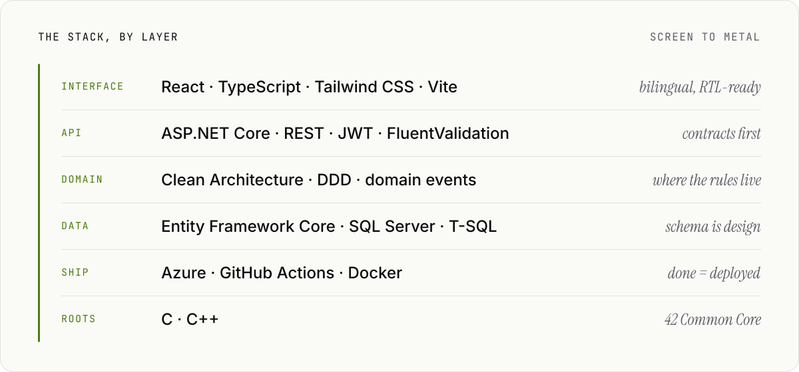
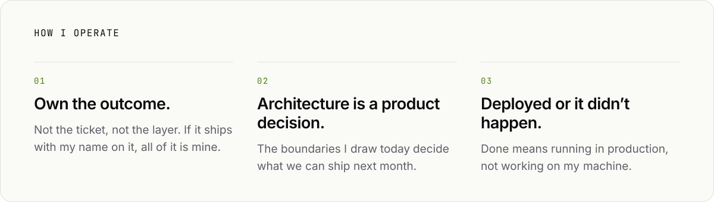
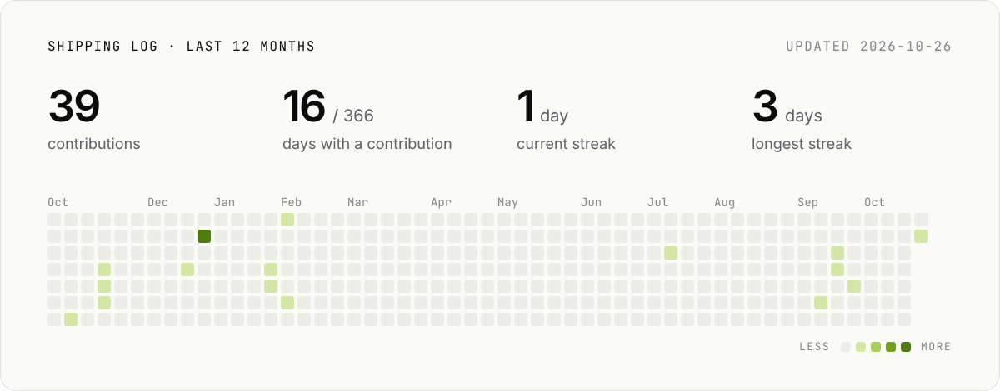
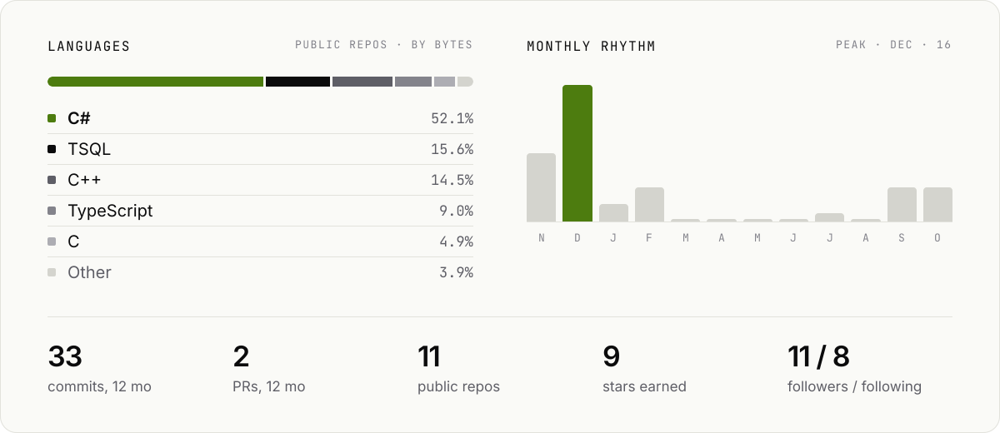

<picture>
  <source media="(prefers-color-scheme: dark)" srcset="assets/hero-dark.svg">
  
</picture>

 

<picture>
  <source media="(prefers-color-scheme: dark)" srcset="assets/raha-dark.svg">
  
</picture>

<a href="https://github.com/Amro-Aladghem/MZN-Hackatoon">
  <picture>
    <source media="(prefers-color-scheme: dark)" srcset="assets/taskalyze-dark.svg">
    
  </picture>
</a>

 

**Also built** &nbsp;·&nbsp; [**Online Store**](https://github.com/YazenJO/Online-Store) — React 19 storefront and admin dashboard on an ASP.NET Core 9 API with role-based JWT auth &nbsp;·&nbsp; [**DVLD**](https://github.com/YazenJO/DVLD-Project) — driving-licence management system, three-tier C# on SQL Server &nbsp;·&nbsp; [**42**](https://github.com/YazenJO/42) — C, from the 42 Common Core

 

<picture>
  <source media="(prefers-color-scheme: dark)" srcset="assets/stack-dark.svg">
  
</picture>

<picture>
  <source media="(prefers-color-scheme: dark)" srcset="assets/principles-dark.svg">
  
</picture>

<picture>
  <source media="(prefers-color-scheme: dark)" srcset="assets/activity-dark.svg">
  
</picture>

<picture>
  <source media="(prefers-color-scheme: dark)" srcset="assets/footprint-dark.svg">
  
</picture>

 

  <a href="https://www.linkedin.com/in/yazen-abusharkh-0xzr"><b>LinkedIn</b></a> &nbsp;·&nbsp;
  <a href="mailto:yazenbilal2005@gmail.com"><b>yazenbilal2005@gmail.com</b></a> &nbsp;·&nbsp;
  CS at The Hashemite University

